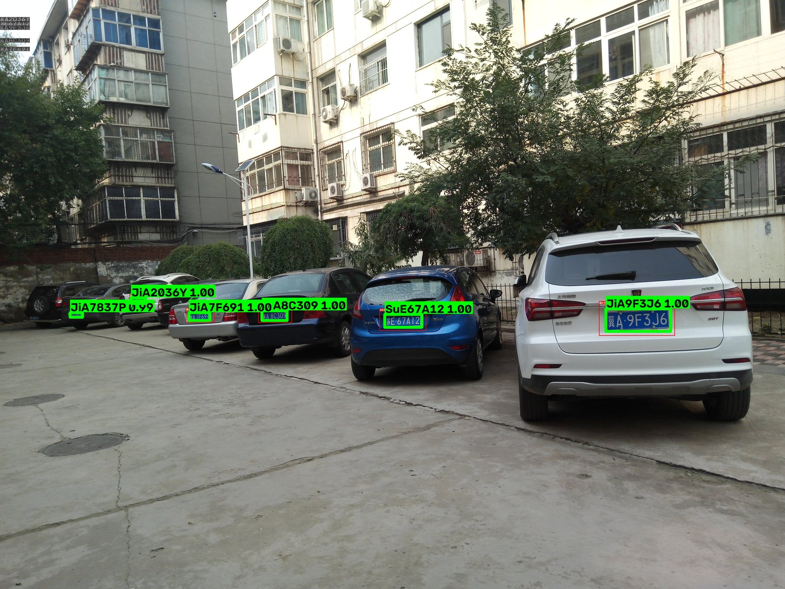

# License Plate Recognition

基于 Python 的车牌识别双方案对照系统：以 **HyperLPR3 集成式识别**作为基础模型，以 **YOLO 车牌检测 + LPRNet 字符识别的分步式模型**作为对照，在同一组图片上比较整牌识别正确率、耗时与失败案例。

> 多媒体技术实践课程项目

---

## 一、项目简介

系统接收车辆图像作为输入，自动定位车牌区域并识别完整车牌号码，输出标注车牌框与号码的结果图片，可应用于停车场道闸、小区门禁、高速收费、交通卡口等场景。

本项目实现并对照两种方案：

| 方案 | 架构 | 特征 |
| --- | --- | --- |
| 方案一（基线） | HyperLPR3 集成式 | 框架内部端到端完成检测与识别，一次调用直接输出号码；**已实现并完成 CPU 实测** |
| 方案二（对照） | YOLO + LPRNet 分步式 | 检测与识别拆分为独立模块，可分别替换与调优 |

---

## 二、技术架构

### 方案一：集成式

```
输入图片
   │
   ▼
[ HyperLPR3 内部完成检测 + 识别 ]
   │
   ▼
车牌号码 + 位置
```

### 方案二：分步式

```
输入图片
   │
   ▼
[ YOLO 车牌检测 ] ── 轴对齐边界框
   │
   ▼
[ 裁剪车牌区域 ]
   │
   ├── 候选 0：原图（保底，永远参与比较）
   └── 候选 1：角点回归网络预测四顶点 → 透视拉正成标准长方形
   │
   ▼
[ LPRNet 字符识别 ] ── CTC 解码，同时给出置信度
   │
   ▼
取置信度最高的候选 ── 车牌号码 + 位置
```

### 分步式的自动拉正（角点回归）

YOLO 的 detect 头只输出轴对齐矩形的 4 个数，**数学上拿不到车牌的旋转**，
倾斜车牌因此会被连着背景一起裁出来，再被拉伸到 168×48。

`corner_net.py` 用一个约 2 MB 的卷积网络，直接从裁剪图回归出车牌的**四个真实顶点**，
再按这四点做透视变换，把平行四边形拉成标准长方形（倾斜 6–15° 场景 82.1% → 92.9%）。

它同样**不会替换原图**：原图与拉正版一起送 LPRNet，取 CTC 置信度最高者，
所以只赚不赔。300 张 CCPD 从 **91.0% → 94.7%**，自采集 8 张湘牌从 **4/8 → 7/8**。
详见 [docs/corner_net.md](docs/corner_net.md)。

> 也尝试过颜色连通域、霍夫直线、字符笔画等六种纯几何方法求顶点，全部低于 baseline，
> 原因与实验表都记在 docs/corner_net.md 第 2 节。

两方案使用统一的可视化与评估口径（`common` 模块），保证对照公平。

---

## 三、项目结构

```
license-plate-recognition/
├── README.md
├── LICENSE
├── .gitignore
├── requirements.txt                # 完整依赖（双方案）
├── requirements-basic.txt          # 方案一最小依赖
├── config/config.yaml              # 双方案配置
├── src/plate_recognition/
│   ├── integrated/                 # 方案一：HyperLPR3
│   ├── two_stage/                  # 方案二：YOLO + LPRNet
│   │   ├── detector.py             #   YOLOv8 检测
│   │   ├── corner_net.py           #   角点回归网络（四顶点 + 透视拉正）
│   │   ├── deskewer.py             #   纯几何兜底（颜色四边形）
│   │   ├── recognizer.py           #   LPRNet 识别 + CTC 置信度
│   │   └── pipeline.py             #   串联 + 多候选择优
│   └── common/                     # 共用 IO、可视化、指标
├── scripts/
│   ├── run_integrated.py           # 运行集成式
│   ├── run_two_stage.py            # 运行分步式
│   ├── compare.py                  # 双方案对照
│   ├── parse_ccpd.py               # CCPD 真值解析
│   ├── evaluate.py                 # 按真值评估识别结果
│   ├── train_corner_net.py         # 训练角点回归网络
│   └── compare_deskew.py           # 消融实验：不拉正 vs 自动拉正
├── weights/                        # 权重（不进 git）
├── data/test_images/               # 测试图片（300 张 CCPD，随仓库提供）
├── samples/demo2.jpg               # 自带示例图，开箱即用
├── output/
│   ├── integrated/
│   ├── two_stage/
│   └── comparison/
├── docs/
│   ├── project_structure.md
│   ├── experiment_design.md
│   ├── hyperlpr3_baseline.md       # 方案一环境搭建与实测记录
│   ├── deskew.md                   # 纯几何拉正：原理、实验与结论
│   └── corner_net.md               # 角点回归拉正：结构、训练与实测
└── tests/
    ├── test_smoke.py
    ├── test_integrated.py
    ├── test_two_stage_pipeline.py
    ├── test_deskew.py
    └── test_corner_net.py
```

---

## 四、环境要求

- 操作系统：Windows / Linux / macOS
- Python：3.9 – 3.14（已在 Python 3.14 + WSL2 Ubuntu 上验证）
- CPU 或 GPU（NVIDIA CUDA）均可，无需重新训练即可推理

---

## 五、快速开始

### 1. 克隆仓库

```bash
git clone https://github.com/LBF1105/license-plate-recognition.git
cd license-plate-recognition
```

### 2. 安装依赖

```bash
# 只跑方案一（基础任务）：最小依赖
pip install -r requirements-basic.txt

# 需要双方案完整对照时（含 torch / ultralytics，体积较大）
pip install -r requirements.txt
```

> - Ubuntu 24.04+ 的 Python 受 PEP 668 保护，建议先建虚拟环境：
>   `python3 -m venv .venv && source .venv/bin/activate`。
> - 首次运行方案一会自动下载 HyperLPR3 模型（约 12 MB）到 `~/.hyperlpr3/`，
>   需要联网；下载完成后可离线使用。

### 3. 准备测试图片

- **仓库自带 `samples/demo2.jpg`**，克隆后无需任何额外准备即可跑通全流程；
- `data/test_images/` 随仓库提供 300 张 CCPD 随机样本（约 27 MB），
  来源与复现方式见 [`data/README.md`](data/README.md)；
- 要测自己的图片，直接放入 `data/test_images/` 即可。

### 4. 运行方案

```bash
# 方案一：集成式（默认扫描 data/test_images）
python scripts/run_integrated.py --tile

# 方案一：指定单张图片或任意目录
python scripts/run_integrated.py --source samples/demo2.jpg --tile
python scripts/run_integrated.py --source /path/to/photos --tile

# 方案二：分步式（需先按 weights/README.md 准备权重）
python scripts/run_two_stage.py --source data/test_images

# 方案二：关掉自动拉正，退回纯 AABB 裁剪（对照用）
python scripts/run_two_stage.py --source data/test_images --no-deskew
```

`--source` 默认值为 `data/test_images`，不带参数即批量检测该目录下所有图片。

### 5. 批量检测大量图片

目录输入本身就是批量模式，再配合并行、断点续跑与 CSV 汇总即可：

```bash
# 4 进程并行 + 分块检测 + 跳过已处理图片（中断后可继续）
python scripts/run_integrated.py --source data/test_images --tile --workers 4 --skip-existing
```

| 参数 | 说明 |
| --- | --- |
| `--workers N` | 多进程并行，建议 4～8（约 CPU 核数的一半） |
| `--skip-existing` | 结果图已存在就跳过，支持中断后断点续跑 |
| `--no-save` | 不保存结果图，只写 CSV，吞吐最高 |
| `--recursive` | 递归子目录（CCPD 按子集分文件夹时使用） |
| `--csv PATH` | 汇总 CSV 路径，默认 `output/integrated/results.csv` |

实测：12 张 4608×3456 图片、`--tile`、2 进程，总耗时 8.6 s，共识别 72 个车牌；
CSV 为 `image, plate, confidence, x1, y1, x2, y2, elapsed_ms`，采用 utf-8-sig 编码，
Excel 直接打开中文不乱码。

### 6. 双方案对照

```bash
# 1. 两方案分别批量识别（只输出 CSV）
python scripts/run_integrated.py --source data/test_images --no-save --csv samples/results/integrated_ccpd.csv
python scripts/run_two_stage.py --source data/test_images --no-save --csv samples/results/two_stage_ccpd.csv
# 2. 各自对照 CCPD 真值评估
python scripts/evaluate.py --results samples/results/integrated_ccpd.csv --output samples/results/eval_integrated.md
python scripts/evaluate.py --results samples/results/two_stage_ccpd.csv --output samples/results/eval_two_stage.md
# 3. 生成并排对照报告（总览 + 分场景 + 失败交集）
python scripts/compare.py --integrated samples/results/integrated_ccpd.csv --two-stage samples/results/two_stage_ccpd.csv --output samples/results/comparison.md
```

对照报告输出到 `samples/results/`，实验设计见 [`docs/experiment_design.md`](docs/experiment_design.md)。

---

## 六、方案一实测结果（CPU）

测试图 `samples/demo2.jpg`（4608×3456，小区停车场景，可见 6 个车牌）：

| 模式 | 识别数量 | 识别到的车牌 |
| --- | --- | --- |
| low（320×320） | 2 | 冀A9F3J6、冀A7F691 |
| high（640×640） | 3 | 冀A9F3J6、冀A8C309、苏E67A12 |
| high + 分块 3×2 | 6 | 冀A8C309、冀A7F691、冀A7837P、冀A2036Y、苏E67A12、冀A9F3J6 |

效果示例（`--tile` 模式）：



- **绿色框**：检测到的车牌区域，四个角坐标 `(x1, y1)`、`(x2, y2)` 就是返回结果里的
  `bbox`，均基于原图坐标系，可直接用于裁剪或二次定位。
- **框上方绿底黑字**：识别号码的拼音形式（`冀A9F3J6` → `JiA9F3J6`）与置信度；
  OpenCV 不支持中文绘制，所以用拼音替代。
- 颜色本身没有语义：代码统一用绿色（BGR `(0, 255, 0)`）高亮，不代表车牌类型或识别状态。

### 在 300 张 CCPD 随机样本上的实测

用 `data/test_images/` 中随机抽取的 300 张 CCPD2019 图片（原图 720×1160）对比两种模式：

| 模式 | 检出情况 | 整牌正确率 | 耗时（301 张，2 进程） |
| --- | --- | --- | --- |
| high 整图 | 300 张全部检出，0 张漏检，2 张误检出额外车牌 | **96.3%**（289/300；字符准确率 99.5%） | 19.2 s（0.12 s/张） |
| high + 分块 3×2 | 共检出 182 个车牌（含 demo2 的 6 个），大量图片漏检 | — | 61.2 s（0.40 s/张） |

检测指标（IoU≥0.5 匹配）：精确率 99.3%、召回率 100%。
错误几乎全是**省份字混淆**（琼→鲁、川→浙、皖→陕/苏/沪/粤、藏→苏），号码后 6 位基本全对。

**结论**：CCPD 这类车牌在图中占比大的小图应使用**整图模式**；分块只用于
`samples/demo2.jpg` 这类 4608×3456 的大图（车牌很小、整体缩放后容易漏检）。

### 双方案对照结果（同一批 300 张 CCPD 模糊子集）

| 指标 | 方案一 HyperLPR3 集成式 | 方案二 YOLOv8+LPRNet 分步式 |
| --- | --- | --- |
| 检测精确率 / 召回率 | 99.3% / 100% | 99.0% / 100% |
| 整牌正确率 | **96.3%**（289/300） | 91.0%（273/300） |
| 字符准确率 | 99.5% | 97.6% |
| 平均耗时 | 0.08 s/张 | 0.06 s/张 |
| 明显倾斜（>15°）整牌正确率 | 94.3% | 62.9% |

差距不在检测（两方案召回率均为 100%），而在识别的抗倾斜能力：车牌基本水平时
两方案仅差 0.6 个百分点，明显倾斜时拉开到 31 个百分点——集成方案内部带车牌
校正，分步式直接裁剪轴对齐框、无透视校正。分步式的优势是速度更快且结构透明、
可逐环节改进（透视校正、省份字后处理校正）。完整报告见 `samples/results/`
下的 `eval_integrated.md`、`eval_two_stage.md` 与 `comparison.md`。

#### 怎么评估

CCPD 的边界框、真实号码、模糊度、倾斜角、亮度都编码在文件名里，真值不需要额外标注。
用 [`scripts/evaluate.py`](scripts/evaluate.py) 对照识别 CSV 自动生成报告：

```bash
# 1. 批量识别（只输出 CSV，不写结果图，速度更快）
python scripts/run_integrated.py --source data/test_images --no-save \
    --csv samples/results/ccpd300.csv
# 2. 对照真值评估
python scripts/evaluate.py --results samples/results/ccpd300.csv \
    --output samples/results/eval_report.md
```

报告包含：检出率、检测 TP/FP/FN 与精确率/召回率、整牌正确率、字符准确率、
耗时（均值 / P50 / P95）、按模糊度/倾斜/亮度分场景的准确率，以及失败案例清单。
方案二输出同样格式的 CSV 后，可直接复用这个脚本对比。

单张 CPU 推理约 0.4 s（整图）/ 0.9 s（分块）。环境搭建步骤、参数影响与失败案例分析见
[`docs/hyperlpr3_baseline.md`](docs/hyperlpr3_baseline.md)。

---

## 七、数据集

使用公开中文车牌数据集 **CCPD（Chinese City Parking Dataset）**，包含正常、模糊、旋转、倾斜、光照不均、雨雪天气等场景子集，详见 [`data/README.md`](data/README.md)。

---

## 八、测试

```bash
pytest tests/
```

---

## 九、团队分工

| 成员 | 技术分工 | 报告分工 | PPT 分工 |
| --- | --- | --- | --- |
| 成员 A（分步式负责人） | 方案二代码维护、代码整合与仓库管理 | 第三节方案二实现与关键代码；第五节总结与收获 | 方案二实现与改进方向页 |
| 成员 B（集成式负责人） | 方案一与评估工具维护；生成双方案对照报告 | 第二节项目简介与技术方案；第三节环境配置与方案一实现 | 项目简介与技术路线、方案一页 |
| 成员 C | 测试组织：制定亲测记录格式、汇总四人测试结果与统计表；三组案例标注图制作 | 第四节测试结果与分析（统计与结果部分） | 测试结果与对照分析页 |
| 成员 D | 技术流程图绘制；拓展实验（OpenCV 图像增强前后对比）；结果图整理 | 第二节流程图；第四节失败案例分析与拓展任务；第六节参考资料与工具使用说明 | 封面、目录、流程图、案例与拓展页；全稿统稿串联 |

共同规则：

- 每位成员亲自完成至少 5 张不同车辆图片的识别测试并按统一格式记录，结果交成员 C 汇总；
  任何人不得仅承担文档排版或 PPT 制作工作（实验报告模板的明确要求）。
- 报告与 PPT 实行“谁的活谁写”：各成员撰写、制作自己分工对应的章节与页面，
  成员 D 只做统稿（统一格式、拼合、校对）与串联页，不代写。
- 组长负责最终打包提交：按提交清单核对材料、按规范命名、发送邮件。

---

## 十、许可证

基于 [MIT License](LICENSE) 开源。

---

## 十一、参考资料

- [HyperLPR3](https://github.com/szad670401/HyperLPR)
- [Ultralytics YOLO](https://github.com/ultralytics/ultralytics)
- [CCPD 数据集](https://github.com/detectRecog/CCPD)
- LPRNet: License Plate Recognition via Deep Neural Networks

本项目在环境配置、代码理解与调试过程中使用了 AI 工具辅助，所有实验结果与数据均来自实际运行。
